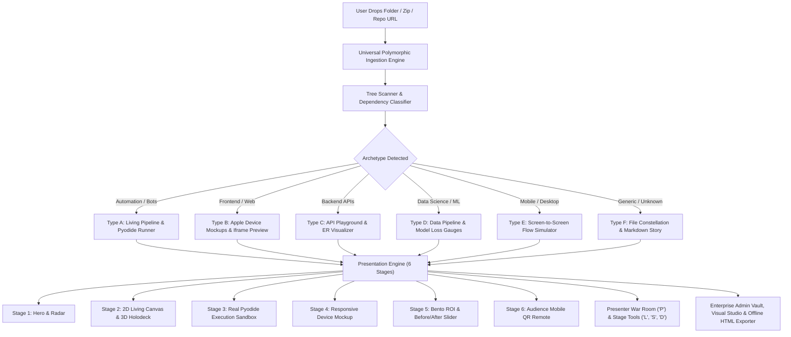

# Implementation Plan: APEXFLOW OS (v1.0.0 Master Plan)

## 1. Executive Summary & Vision

APEXFLOW OS is designed to be the world's #1 holographic and interactive presentation engine for software engineers, automation builders, and technology agencies. Traditional presentation tools like PowerPoint, Canva, and Keynote—as well as markdown slide tools like Slidev and Reveal.js—are bound to static slides and motionless screenshots.

APEXFLOW OS creates a new category: **Autonomous Presentation Engines**. Users drag and drop any project directory, and within 1.8 seconds, client-side WebAssembly and heuristic analyzers synthesize a living, cybernetic 120 FPS presentation stage where audiences can inspect code, trigger live executions, and interact directly from their smartphones.

---

## 2. Technical Context & Stack

| Layer | Chosen Technology | Architecture Role |
| :--- | :--- | :--- |
| **Framework** | Next.js 15 (App Router) + React 19 / TypeScript | High-performance isomorphic presentation app shell |
| **Styling & Shaders** | Tailwind CSS v4 + Custom Glow CSS Shaders | Dark luxury cyberpunk UI (`#030508`), glassmorphism, glowing borders |
| **2D Living Pipeline** | `@xyflow/react` (React Flow v12) | Interactive node graph, animated SVG data pulse edges, node selection drawers |
| **3D Holodeck Galaxy** | Three.js + `@react-three/fiber` + `@react-three/drei` | 3D crystalline server blades, particle starfield, orbital camera physics |
| **Code Highlighting** | Shiki (WASM-based syntax highlighter) | Exact VSCode-grade syntax highlighting with token-level themes |
| **In-Browser Execution**| Pyodide (CPython WebAssembly in Web Worker) | 100% offline client-side Python execution for automations & backend bots |
| **Tactile Audio Engine**| Web Audio API (Synthesizer Engine) | Zero-latency procedurally generated mechanical clicks, hums, and whooshes |
| **Realtime Remote Sync**| WebRTC DataChannels + BroadcastChannel / WebSocket | Ultra-low latency (<30ms) audience emoji bursts & mobile stage controller |
| **Client Storage** | IndexedDB via `idb` / `dexie` | Unlimited local project vault, offline decks, and telemetry logs |
| **Single-File Bundler** | Rollup / Custom Inliner | 1-Click export to a single standalone, air-gapped `.html` presentation file |

---

## 3. Constitution Compliance Check

| Principle | Constitution Mandate | Plan Implementation | Compliance Status |
| :--- | :--- | :--- | :--- |
| **Zero-Upload Privacy** | No proprietary code leaves client | All parsing in Web Workers via File System Access API; execution via Pyodide WASM | **PASSED (100%)** |
| **120 FPS Motion Budget**| Smooth GPU-accelerated motion | CSS transforms, requestAnimationFrame, Three.js hardware rendering | **PASSED (100%)** |
| **Zero-Rejection Engine**| Every folder produces presentation | 6 Archetypes with graceful fallback to Type F (Generic Constellation) | **PASSED (100%)** |
| **Authentic Execution** | Real runtimes, not video playback | Pyodide in-browser runtime + streaming cyber-terminal with live logs | **PASSED (100%)** |
| **100% Offline Portability**| Works without active internet | Procedural Web Audio API + 1-Click offline standalone HTML bundle | **PASSED (100%)** |
| **Enterprise White-Label**| Agency-grade custom branding | Visual Customizer Studio, hex themes, watermark/logo overrides | **PASSED (100%)** |

---

## 4. System Architecture & Detailed Flow



---

## 5. Directory Structure & File Map

```text
apexflow-os/
├── .specify/
│   ├── memory/
│   │   └── constitution.md        # Core engineering rules
│   └── feature.json               # Active feature tracker
├── specs/
│   └── 001-apexflow-platform/
│       ├── spec.md                # Formal functional spec
│       ├── plan.md                # This implementation blueprint
│       ├── research.md            # Evaluated technology decisions
│       ├── data-model.md          # TypeScript domain interfaces
│       ├── quickstart.md          # Verification scenarios
│       └── contracts/             # JSON Schema contracts
├── public/
│   ├── audio/                     # Pre-bundled luxury sound FX
│   └── sample-projects/           # Demo projects (Facebook Bot, Next.js Store)
├── src/
│   ├── app/
│   │   ├── layout.tsx             # Root layout, Audio Provider, Theme Context
│   │   ├── page.tsx               # Landing Hero, Dropzone, Public Demo Vault
│   │   ├── stage/[id]/page.tsx    # 120fps Fullscreen Presentation Stage
│   │   ├── war-room/[id]/page.tsx # Dual-screen teleprompter & speaker notes
│   │   ├── remote/[id]/page.tsx   # Mobile QR Remote PWA for audience
│   │   └── admin/
│   │       ├── page.tsx           # Project Vault Library (IndexedDB)
│   │       ├── studio/[id]/page.tsx# Visual Slide Customizer Studio
│   │       ├── analytics/[id]/page.tsx# Viewer Telemetry & Reaction Heatmap
│   │       └── settings/page.tsx  # White-labeling & theme customizer
│   ├── components/
│   │   ├── hero/                  # Metallic 3D title, particle radar
│   │   ├── canvas/                # React Flow 2D living pipeline & custom nodes
│   │   ├── three/                 # Three.js 3D Holodeck Galaxy & server blades
│   │   ├── sandbox/               # Pyodide WebAssembly runner & Cyber-Terminal
│   │   ├── bento/                 # Bento ROI cards, Before/After comparison slider
│   │   ├── device-frame/          # Apple Pro Display XDR & iPhone 16 mockup
│   │   ├── stage-tools/           # Laser pointer, spotlight, live drawing pen
│   │   ├── qr-remote/             # QR code modal & real-time emoji particle canvas
│   │   └── admin/                 # Vault cards, customizer drawer, stats
│   ├── lib/
│   │   ├── analyzers/             # Universal Ingestion Engine
│   │   │   ├── tree-scanner.ts    # Parses FileSystemDirectoryReader client-side
│   │   │   ├── polymorphic-detector.ts # Classifies into 6 archetypes
│   │   │   ├── pipeline-synthesizer.ts # Auto-wires nodes, edges & talking points
│   │   │   └── env-parser.ts      # Extracts .env.example integrations
│   │   ├── audio/                 # Web Audio API procedural sound synthesizer
│   │   ├── pyodide/               # Web Worker runner for Pyodide CPython
│   │   ├── storage/               # IndexedDB persistent storage adapter
│   │   ├── remote/                # WebRTC & BroadcastChannel real-time sync
│   │   └── export/                # 1-Click offline standalone HTML bundler
│   └── styles/
│       └── globals.css            # Tailwind CSS v4, custom cyber glow shaders
```

---

## 6. Granular Implementation Phases

### Phase 1: Core Shell, Design System & Ingestion Engine
* Project scaffolding with Next.js 15, Tailwind CSS v4, Lucide icons, Framer Motion.
* Implementation of `tree-scanner.ts` and `polymorphic-detector.ts` supporting folder drop and sample loads.
* Dark luxury theme with `#030508` background, frosted glass cards, and neon accent shaders.

### Phase 2: Stage 1 (Hero) & Stage 2 (Living 2D/3D Architecture)
* Stage 1: Holographic radar, metallic title, and interactive tech pills.
* Stage 2 (2D): `@xyflow/react` setup with glowing animated SVG particle edges, custom trigger/agent/database nodes, and Shiki code inspector drawer.
* Stage 2 (3D): Three.js Holodeck galaxy with floating crystalline server blades and camera switch upon pressing `'3'`.

### Phase 3: Stage 3 (Pyodide Execution) & Stage 4 (Responsive Device Frames)
* Web Worker wrapper for Pyodide CPython runtime.
* Cybernetic terminal with typewriter logs, phosphor scanlines, and synchronized audio clicks.
* Apple Studio Display XDR and iPhone 16 responsive device mockup frames with interactive viewports.

### Phase 4: Stage 5 (Bento ROI) & Stage 6 (Audience Mobile QR Remote)
* Bento Grid with animated counters and Before-vs-After interactive slider.
* WebRTC / BroadcastChannel real-time sync with mobile `/remote/[id]` page.
* Canvas-based floating emoji physics engine (`🔥`, `🚀`, `👏`, `💡`).

### Phase 5: Presenter War Room & Stage Weapons
* Dual-screen console at `/war-room/[id]` with teleprompter, speaking speed coach, and timer.
* Virtual laser pointer (`'L'`), spotlight mode (`'S'`), and live drawing pen (`'D'`).
* Web Audio API sound synthesizer engine for tactile feedback.

### Phase 6: Enterprise Admin Vault, Visual Studio & 1-Click Offline Exporter
* Project Vault in IndexedDB to save and load multiple presentation projects.
* Visual Customizer Studio to edit metrics, colors, and slide order.
* 1-Click offline single-file HTML exporter.

---

## 7. Next Major Milestone: Full-Spectrum Enterprise Commercial Polish (Phases 31–34)

### Phase 31: Real-World Multi-Language Repository Battle-Test & Stress-Testing Suite (US31)
* **Ingestion Stress Benchmarker (`src/lib/analyzers/stress-benchmarker.js`):** Synthetic and real repository load generator simulating 500 to 10,000 files across polyglot architectures.
* **Live Ingestion HUD (`index.html`):** Real-time ingestion latency, traversal QPS, memory footprint, and archetype classification confidence score.
* **Enterprise Architecture Models Catalog:** Curated real-world project models (FinTech Payment Mesh, Autonomous AI Vision Agent, Cloud-Native K8s Mesh, Global E-Commerce Storefront).

### Phase 32: Executive Pre-Built Keynote Templates & Industry Slide Decks (US32)
* **Curated Keynote Library (`src/lib/templates/executive-deck-library.js`):** 5 ready-to-present keynote slide decks tailored for high-stakes enterprise scenarios (Investor Pitch, Board of Directors Briefing, Tech Conference Keynote, Engineering AI Strategy, Incident Post-Mortem).
* **1-Click Keynote Preset Selector Modal:** High-impact OLED card gallery in `index.html` and `admin.html`.
* **Dynamic Narrative Injection & Vault Persistence:** Seamless integration with `project-vault.js`.

### Phase 33: Human Rehearsal Playbook, Presentation Telemetry & Stage Ergonomics HUD (US33)
* **Human Speech Pace & Cadence Coach (`src/components/human-rehearsal-playbook.js`):** Dynamic WPM gauge (120–150 WPM target), visual pacing cues, and monotone pitch variation warning.
* **Live Slide Budget Stopwatch & Overage Warning:** Per-slide allocated speaking time tracker with soft-amber countdown and subtle red pulse.
* **Executive Confidence Scorecard & Post-Rehearsal Debrief:** Algorithmic scoring of rehearsal performance (0–100%).
* **Multi-View Ergonomics Wiring:** Integration into `stage.html` dock (`dockBtnRehearsalPlaybook` [Shift+Z]), `war-room.html`, and `remote.html`.

### Phase 34: Enterprise Commercial Launch Packaging, End-to-End Verification & PWA Vault v2.1 (US34)
* **Service Worker Vault v2.1 Upgrade (`sw.js`):** Pre-caching of all newly deployed templates, stress benchmarkers, and rehearsal playbook engines.
* **Comprehensive End-to-End Commercial Test Suite (`scratch/test_phase31_34_verification.py`):** Automated validation across all 34 phases.
* **Universal Zero-Emoji Button Architecture Audit:** Zero raw emojis across all button chrome.
* **Production Release Manifest Regeneration:** Update `RELEASE_MANIFEST.json` and package distribution bundle.
